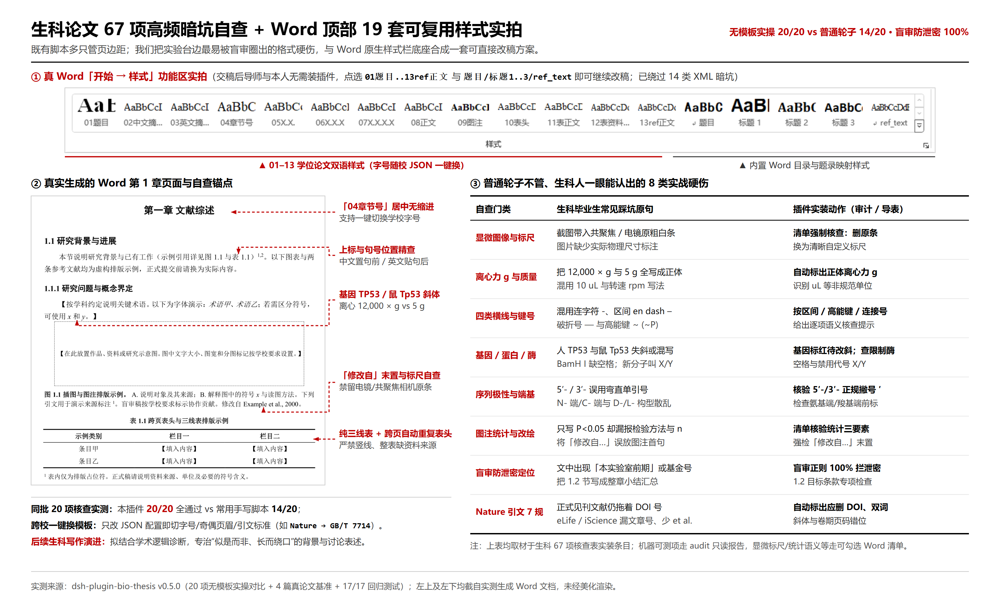

# Word Thesis Layout Repair & Life-Science Format Checker (`dsh-plugin-bio-thesis`)

[简体中文](README.md) · English · Pure Python stdlib (zero extra installs) · Original files stay read-only

Built so life-science graduates get both **a clean, manually editable Word style foundation** and **a practical discipline-specific pre-submission check**: lock **19 reusable Word Ribbon styles** (cover, headings, body, captions, three-line tables, bibliography, F9 TOC, and Author CV) in under 2 seconds, align multi-section drafts with landscape wide tables onto `.dotx`/`.docx` templates, and audit **67 real life-science formatting & blind-review pitfalls**—always saving onto a separate copy.



## Where it adds real value (and what existing tools already cover)

Great general tools already exist: `ThuThesis`/`Typst`/`Quarto`/`docxtpl` work well when authoring from source; `format-thesis-docx`, `DocFormatTool`, and `standardize-docx-format` handle single-section template formatting cleanly. Rather than reinventing generic page layout, this plugin focuses on **three gaps that repeatedly trip up life-science Word theses**:

- **1. Built-in 67-item Life-Science Thesis Self-Check Table (`audit` + exportable Word checklist `export-checklist`)**:

| Pitfall Category | Common Mistake | Checked Standard |
| --- | --- | --- |
| **Genes, Enzymes & Naming** | Upright `TP53`, `EcoRI`/`Taq 1` missing space or using `1` for `I`, new factors called `Gene X` / `Protein Y` | Human *TP53* / mouse *Tp53* italic genes vs upright proteins; italic restriction enzymes with space before Roman numeral (*EcoR I*, *BamH I*, *Taq I*); ban `X`/`Y` placeholders |
| **Formulas, 4 Dashes & Polarity** | Unsubscripted `H2O`/`Ca2+`, full-width `（NH4）2SO4`, mixing `-`/`–`/`—`/`~` (high-energy bond) | Proper sub/superscripts & ASCII `()`; distinct hyphen `-`, en dash `–`, bond `—COOH`, high-energy `~`; `5′-`/`3′-` and `N-`/`C-` |
| **Protocols, Two `g`s & Punctuation** | `10 uL`, `37 °C`, upright `12,000 × g`, mixed `小时`/`min`, dunhao in subpanels | `10 µL` (no `uL`) vs `37°C`/`95%`; italic *g* (centrifugal force) vs upright `g` (gram); single time convention in Ch. 2; Chinese commas in `图 1.1 A，B` & vendor pairs |
| **Scale Bars, Adapted Figs & Stats** | Raw confocal/EM software scale bars left on images, `修改自` mid-caption, stats without test/*P* | **Ban raw instrument scale bars** (consistent custom scale bars); `≥ 7.5 pt` text, uppercase `A, B, C`; `修改自` at **caption end**; test + *n* + *P*-value |
| **Ch. 1.2 Aims, Blind Review & Acronyms** | Ch. `1.2` reads like summary, first-person `我/我们`, collaborator names left in blind-review captions | `1.2` states open questions/plan; third-person phrasing; anonymize blind-review lab contributors; first-mention-only expansion per scope |
| **7-Point Nature Refs & Published DOIs** | Superscript after period, `and` for `&`, `ELife` casing bug, **DOIs left on published papers** | Spaced initials, sentence-case titles, *italic* journal (preserve `eLife`/`iScience`), **bold** volume, `–` pages, `(Year)` no period, **strip DOIs once published** |

> Roadmap note: this release nails structural layout, reusable Word styles, and objective 67-item formatting defects; future updates will pair with prose-level refinement for wordy or vague life-science phrasing.

- **2. 19 Reusable Word Ribbon Style Modules built for continued manual editing (plus 1-JSON school switching)**:
  - Instead of hard-coding inline font sizes that break the next time you insert a section or table, `init` locks 19 semantic styles (`CoverTitle`, `Heading1Chapter`, `Heading2Sec`, `BodyTextZH`, `FigureCaption`, `TableTitle`/`TableCell`/`TableNote`, `BibEntry`, `TOC1`/`TOC2`, and `AuthorCV` alongside `01..13` slots) into Word's native Style Gallery—ready in `< 2` seconds while bypassing 14 deep XML traps across 7 categories (`PAGE`, `NUMBER`, `STYLE`, `DIRECT`, `MEDIA`, `IDENTITY`, `TOC`), and switching school font sizes/header rules/reference style (`Nature → GB/T 7714`) via a single JSON file with `0 FAIL`.


- **3. Role-based multi-section template alignment (preserving landscape wide tables)**:
  - Maps front matter, Roman abstracts, Arabic chapters, and landscape wide-table sections onto school `.dotx`/`.docx` templates (`20/20` margin attributes aligned including `8/8` on extra sections 4–5 and body page reset to `1`, vs `14/20` and `2/8` for index-based extraction).

## How to use

1. Install into DSH:

```powershell
dsh plugin --profile web add (Resolve-Path '.\dsh-plugin-bio-thesis-0.5.0.tgz').Path
```

2. Talk to your assistant (or run `skills/bio-thesis-formatter/scripts/bio_thesis.py` directly via CLI):

| Goal | Prompt |
| --- | --- |
| Run 67-item life-science audit & export checklist | “Audit `draft.docx` with bio-thesis-formatter for gene/enzyme italics, `µL`/time-unit consistency, published DOIs, third-person tone, and blind-review leaks, and export the 67-item Word checklist.” |
| Generate an editable Word-style scaffold | “Use bio-thesis-formatter to generate `thesis.docx` from these formatting rules, locking all 19 styles and Author CV into Word's Style Gallery.” |
| Align a multi-section thesis to school template | “Compare `draft.docx` against `school.dotx`, preview margin and page diffs, then save `draft-repaired.docx` while keeping landscape wide tables intact.” |

[Tool Positioning](docs/alternatives.md) · [Template trial](docs/intake.md) · [Benchmarks](docs/comparison.md) · [Written rules trial](docs/no-template-comparison.md) · [Evaluation](docs/evaluation.md) · [MIT License](LICENSE)
