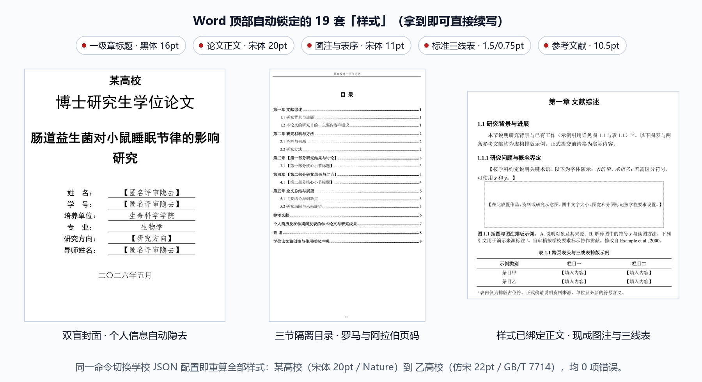

# Word Thesis Layout Repair & Format Checker (`dsh-plugin-bio-thesis`)

[简体中文](README.md) · English · Pure Python stdlib (zero third-party installs) · Read-only on original files

**Ad-hoc LLM formatting scripts often dump hundreds of unbound XML styles into Word that collapse the moment you edit a paragraph—while aligning an existing multi-section manuscript with landscape wide tables against a 3-section `.dotx` school template easily fails on section mismatches or misses finer typography rules. This plugin compiles thesis rules deterministically into locked Word Ribbon styles, role-aware section repairs, and a 67-item pre-submission audit while keeping your source files strictly read-only.**



## What it handles

- **Locks rules & Author CV into 19 Word Ribbon styles**: When you only have written formatting guidelines, generate a ready-to-continue `.docx` covering chapter headings, body text, captions, three-line tables, bibliography, and a structured Author CV section (with automatic identity redaction in `blind` mode). Switching presets across school specs (e.g., 20 pt Songti / Nature to 22 pt Fangsong / GB-T 7714) recalculates cleanly from one command. In benchmarks, a `1,212`-line bare LLM script still left `7` Word formatting errors, whereas the plugin builds a clean **15-page draft in `< 2 s` with `0` throwaway code**.
- **Aligns multi-section theses while protecting landscape wide tables**: Maps front matter, Roman-numbered abstracts, Arabic main chapters, and landscape wide-table islands cleanly onto `.dotx`/`.docx` school templates—previewing exact centimetre diffs across paper size, all 7 `pgMar` fields, mirror margins, headers/footers, and chapter page-1 restarts before saving a repaired copy.
- **Built-in 67-item multi-category format audit**: Unless custom overrides are supplied, default rules verify **figure text `>= 7.5 pt` (`6 号字`)**, **objective third-person prose (banning first-person `我`/`我们`/`本人`)**, **DOIs retained only on ahead-of-print / preprint entries without formal volume/page numbers**, **unified Chinese or English experimental time units**, **Chinese commas inside multi-panel references (`图 1.1 A，B`) and instrument parentheticals (`P-2000，Sutter Instrument`)**, **script-matched spaces (half-width around English/numerals, full-width between Chinese items)**, and **Author CV completeness / blind-review redaction**. Detects **`14/14` planted structural & identity defects with `0` false positives** across 8 test drafts (vs `1/14` and `4/14` for comparable open-source tools).

## Example prompts

| Goal | Prompt |
| --- | --- |
| Align an existing thesis | “Compare draft.docx against school.dotx with bio-thesis-formatter, preview margin and page-number diffs per section, then save draft-repaired.docx.” |
| Start from written rules | “Use bio-thesis-formatter to generate thesis.docx matching these formatting requirements, with headings, body, captions, three-line tables, and Author CV locked into Word styles.” |
| Rigorous pre-submission audit | “Audit draft.docx against school.dotx for layout, figure font size (>= 7.5 pt), third-person tone, online-only DOIs, unified time units, Chinese punctuation spacing, Author CV, and blind-review redaction.” |

## Install & CLI

```powershell
dsh plugin --profile web add (Resolve-Path '.\dsh-plugin-bio-thesis-0.5.0.tgz').Path
```

```powershell
$cli = 'skills/bio-thesis-formatter/scripts/bio_thesis.py'
python -B $cli repair --docx draft.docx --template school.dotx
python -B $cli repair --docx draft.docx --template school.dotx --output draft-repaired.docx
python -B $cli audit --docx draft-repaired.docx --template school.dotx --base-docx draft.docx --md-report review.md
```

[Template trial](docs/intake.md) · [Benchmark comparison](docs/comparison.md) · [Written rules trial](docs/no-template-comparison.md) · [Evaluation](docs/evaluation.md) · [MIT License](LICENSE)
