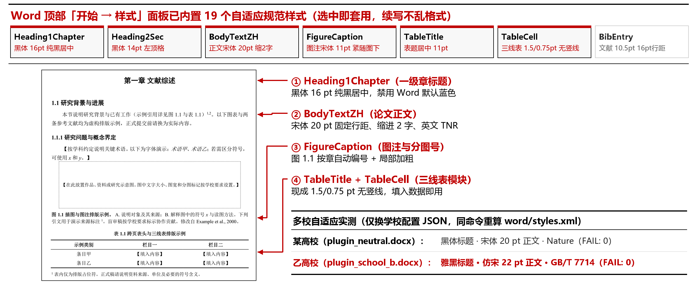
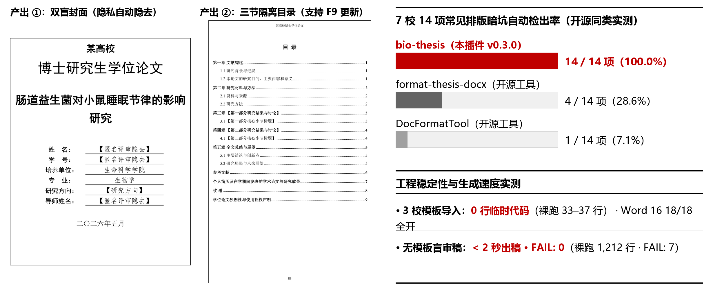

# Thesis Formatting Done Right: Word Ribbon Style Locking, Template-Free Adaptation & 65-Item Blind Audit

[中文说明](README.zh.md) · [No-Template Paired Benchmark](docs/no-template-comparison.md) · [3-School Template Trial](docs/intake.md) · [Head-to-Head Audit Comparison](docs/comparison.md) · [Word Evaluation](docs/evaluation.md)

Whether your department gives you an official `.dotx`/`.docx` template **or only a written list of formatting rules**, this zero-dependency DeepSeek Harness (DSH) plugin handles both sides of thesis preparation cleanly:

1. **Lock school rules into Word's top ribbon Styles so drafts survive real editing**: Preserve an official template verbatim **or adapt the built-in desensitized academic master via JSON `--profile-config`** in one command—writing fonts, line spacing, indents, three-line tables, figure captions, and bibliography formatting into **19 dedicated `qFormat` Styles** plus ready-to-edit sample blocks (`图 1.1` / `表 1.1`). When you keep typing or revising inside Microsoft Word, layout stays intact instead of collapsing.
2. **Catch silent regressions before submission**: Audit section margins and odd/even headers, `core.xml` / split-run blind-review leaks, italic species and genes, `µL` vs `uL`, restriction enzyme spacing, vertical table borders, and uncited or out-of-range references.

---

## Adaptive Word Ribbon Styles & Output Showcase

Given only written school formatting rules (no `.dotx`/`.docx` template), Microsoft Word 16 verification confirms that one command locks all **19 quick-access Styles** into `word/styles.xml` alongside pre-formatted table/caption examples. Switching `--profile-config` JSON adapts fonts and citation styles across universities cleanly (verified `某高校` `SimSun 20pt / Nature` ⇄ `乙高校` `FangSong 22pt / GB/T 7714`, both passing with `AUDIT_SUMMARY=FAIL:0`):



Blind-review cover redaction, 3-section isolated TOC (`F9`-updatable), and our 7-school 14-defect automated audit benchmark against open-source tools:



| Dimension | Bare Coding Agent (Ad-Hoc Python) | Open-Source Baselines | With `dsh-plugin-bio-thesis` (`v0.3.0`) |
|---|---|---|---|
| **Word ribbon Styles & post-edit safety** | Authored **183–1,212 lines** (`7` failures in latest neutral trial: `29` generic styles, missing caption/bib styles, `[1]`/`[9]` bugs) | Pandoc `--reference-doc` drops template covers/frontmatter (`5/12` in 3-school trial) | **0 lines custom code**, `<2s` for a 15-page draft with **19 bound `qFormat` Styles** + editable 3-line table/caption templates |
| **Multi-school rule adaptation** | Requires rewriting script logic per university | `docxtpl` renders tags without rule-driven style recalculation | Swap `--profile-config` JSON -> recalculates `word/styles.xml` (`某高校` ⇄ `乙高校`, `FAIL: 0`) |
| **3-school `.dotx`/`.docx` template intake** | Wrote **33–37 lines** of raw XML glue per run | Template fillers lack post-revision structural auditing | **0 lines conversion code**; all `18/18` outputs passed and opened cleanly in Word 16 |
| **Pre-submission defect detection** | Prone to miss `docProps/core.xml` or split runs | On shared 7-school rules, `format-thesis-docx` caught **4/14** and `DocFormatTool` caught **1/14** | Native CLI caught **14/14 (100%)** shared defects + `8/8` planted no-template defects + 65-item checklist |

*Honest engineering note:* In autonomous skill trials where an agent ran `bio_thesis.py init` and then manually patched raw OOXML (`complete_document.py`), one session corrupted `styles.xml`/`sectPr` so Word refused to open the file. **Always drive formatting via `--profile-config` JSON and CLI flags rather than hand-patching generated XML.** See [No-Template Paired Benchmark](docs/no-template-comparison.md).

---

## 1-Minute Setup & Prompt

Requires Python 3.10+ (**Python standard library only — zero `pip install` needed**) and DSH `0.2.2-rc.5+`.

```sh
dsh plugin --profile web add "github:Spark-xY6/dsh-plugin-bio-thesis#v0.3.0"
```

After restarting the DSH profile, ask:

- **No template file (written rules only):**
  > Use bio-thesis-formatter to adapt the built-in master using a `--profile-config` JSON for my written formatting rules (do not hand-patch generated XML afterward) to create `draft.docx`, and audit `submitted.docx` against those rules into `review.md`.
- **With school `.dotx`/`.docx` template:**
  > Use bio-thesis-formatter to create `draft.docx` from `school.dotx` in blind review stage with title `"Example Study"`. Compare `revised.docx` with `school.dotx` and output `review.md` listing remaining Word visual checks.

### Standalone CLI

```sh
python -B skills/bio-thesis-formatter/scripts/bio_thesis.py init --profile-config presets/custom-university.example.json --mode phd-thesis --review-stage blind --output draft.docx --title-zh "Example Study" --author "Example Author"
python -B skills/bio-thesis-formatter/scripts/bio_thesis.py audit --docx revised.docx --profile-config presets/custom-university.example.json --review-stage blind --sensitive-names "Example Author,Example Advisor" --md-report review.md
python -B skills/bio-thesis-formatter/scripts/bio_thesis.py export-checklist --output checklist.docx
```

---

## Benchmarks & License

- 📊 **[No-Template Comparison](docs/no-template-comparison.md)** · **[3-School Template Intake](docs/intake.md)** · **[14-Defect Audit Comparison](docs/comparison.md)**
- 🔍 **[Alternatives & Sources](docs/alternatives.md)** · **[DSH Host & Word Acceptance](docs/evaluation.md)** · **[GitHub Actions](https://github.com/Spark-xY6/dsh-plugin-bio-thesis/actions)**
- Released under the [MIT License](LICENSE). Placeholder text/tables are structural demonstrations only; refresh TOC fields (`F9`) and inspect signatures/images in Microsoft Word before submission.
