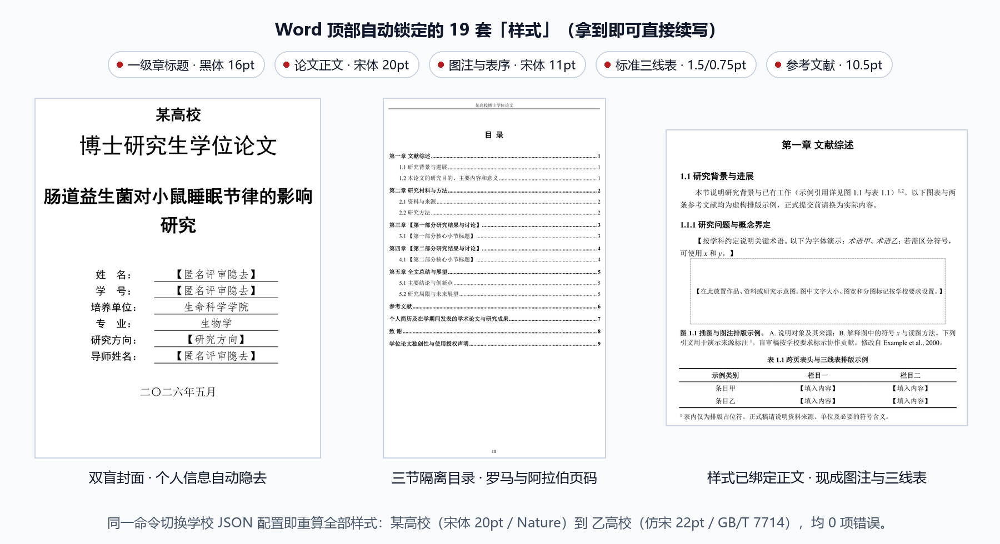

# 论文格式一把过 · bio-thesis

[English](README.md) · [无模板 Word 实测对照](docs/no-template-comparison.md) · [三校模板起稿对照](docs/intake.md) · [14 缺陷与开源工具实测](docs/comparison.md) · [Word 样例验收](docs/evaluation.md)

写学位论文、开题或中期报告时，**不管学院有没有发现成 Word 模板**，让普通 AI 直接现写代码拼文档往往只顾表面看着像：字体字号没有真正绑进样式栏，人手拿过来刚改两段话、插一张图，整章格式就全乱了。

`dsh-plugin-bio-thesis` 用零第三方依赖的纯 Python 标准库解决这件事：手头有 `.dotx`/`.docx` 模板就原样保留起稿；**只有学院书面文字规定、没有现成模板时**，一条命令按 JSON 配置文件重算内置脱敏母版，把章节标题、正文行距、缩进、三线表、图注、表题和参考文献格式全部锁进 **Word 顶部的 19 套专属「样式」**里，并在正文中带好可直接改字填数的图 1.1、表 1.1 样板。交稿前还能把页边距偏差、`core.xml` 与拆分 Run 里的盲审身份漏网词、基因物种斜体、`µL` 单位和三线表竖线一次扫清。



## 实测对比与适用边界

- **无模板文字要求起稿**：针对一份纯文字盲审规定（《某高校肠道益生菌改善睡眠节律》通用样例），直接让独立子代理从零写脚本花了 `1,212` 行 Python，仍被查出 `7` 项格式与引用错（含 `29` 个杂乱默认样式、缺少图注/文献样式、封面日期偏左及不存在的 `[9]` 越界引用）；本插件 **`0` 行定制代码**，不到 `2` 秒输出 15 页 `FAIL: 0` 底稿，且用同一命令从“某高校（宋体 20 pt / Nature）”换校切换至“乙高校（仿宋 22 pt / GB/T 7714）”同样 `FAIL: 0`。
- **有学校模板起稿与开源审计对照**：在三所高校真实 `.docx`/`.dotx` 模板测试中 `0` 行转换代码（裸跑需每轮现写 `33–37` 行）且 18 份成稿全部在 Word 16 正常打开；面对 7 所高校 14 项典型隐性缺陷，原生命令行审计检出 **`14/14`（100%）**，同期实测 `format-thesis-docx` 检出 `4/14`、`DocFormatTool` 检出 `1/14`。详情与原始对照日志见 [docs/no-template-comparison.md](docs/no-template-comparison.md) 与 [docs/comparison.md](docs/comparison.md)。
- **使用时请留意这一点**：如果先运行 `bio_thesis.py init` 生成底稿，再额外让 Agent 手写底层 XML 补丁直接篡改内部标签，曾出现过一次 Word 打不开的问题。**需要修改学校字体、行距或引用体例时，请直接修改 `--profile-config` JSON 或命令行参数，不要手改生成后的 OOXML。**

## 1 分钟安装与常用指令

需要 Python 3.10+（零 `pip install` 依赖）与 DeepSeek Harness `0.2.2-rc.5+`：

```powershell
dsh plugin --profile web add "github:Spark-xY6/dsh-plugin-bio-thesis#v0.3.0"
```

重启对应 profile 后，视你手头资料直接发给助手即可：

> **手里只有书面格式要求（无模板）：** 请用 bio-thesis-formatter，以内置脱敏母版按我的文字要求（把页边距、字号和引文样式写进 JSON profile 配置，不要手改生成后的 XML）生成博士/硕士/开题报告底稿「论文工作稿.docx」，并把「待检稿.docx」按同一套要求查出所有格式和盲审泄露问题，输出「格式检查.md」。

> **手里有学校现成 `.dotx`/`.docx` 模板：** 使用 bio-thesis-formatter，以「学院模板.dotx」生成「论文工作稿.docx」，题目填为「示例研究」，盲审模式隐去作者和导师。另把「修订稿.docx」与这份模板比较，写出「格式检查.md」，列出我还需要在 Word 里人工核对的地方。

脱离 DSH 也可直接运行三条独立命令：

```sh
python -B skills/bio-thesis-formatter/scripts/bio_thesis.py init --profile-config presets/custom-university.example.json --mode phd-thesis --review-stage blind --output draft.docx --title-zh "示例研究" --author "示例作者"
python -B skills/bio-thesis-formatter/scripts/bio_thesis.py audit --docx revised.docx --profile-config presets/custom-university.example.json --review-stage blind --sensitive-names "示例作者,示例导师" --md-report review.md
python -B skills/bio-thesis-formatter/scripts/bio_thesis.py export-checklist --output checklist.docx
```

工作稿中的图、表与引文均为结构占位示例；正式提交前记得在 Word 中选中目录按 `F9` 更新页码，并目视复核签名页、图片内容与跨页表格。更多说明见 [docs/intake.md](docs/intake.md)、[docs/alternatives.md](docs/alternatives.md) 与 [docs/evaluation.md](docs/evaluation.md)，项目采用 [MIT 许可证](LICENSE)。
