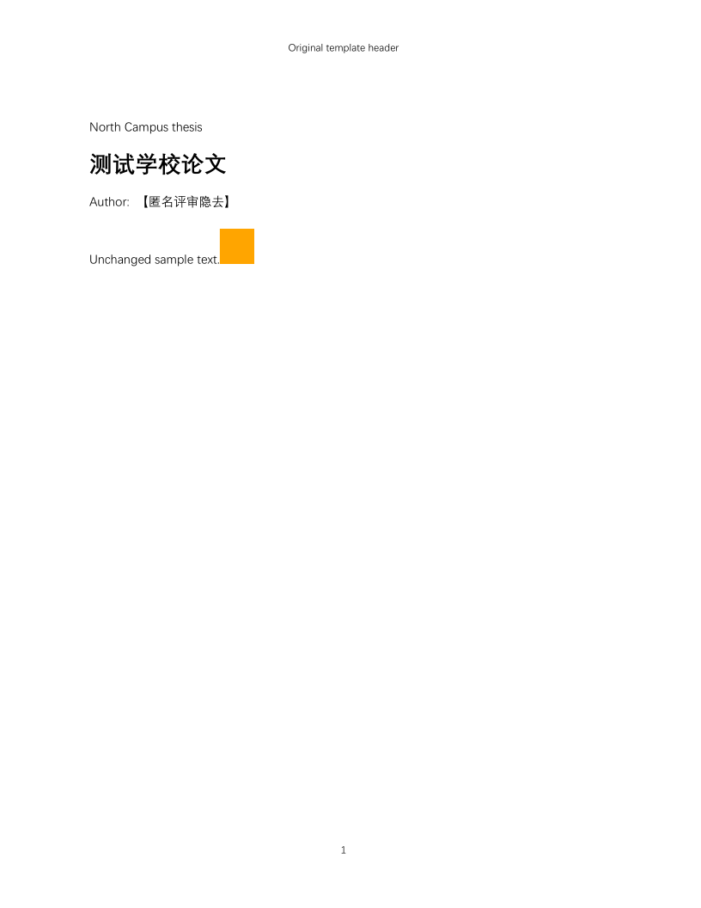

# 从 DSH 安装到 Word 成稿

**插件在真实 DeepSeek Harness（`0.2.2-rc.5`）独立配置中完成安装、技能加载、按学院模板生成盲审底稿、多节长论文跨节修版与交稿前检查。** 在三个刻意破坏的样例上分别准确拦住页边距偏差、姓名残留与标题样式变更；在桌面 Word 16 实测中，多节含 8 列横向宽表的长论文同样通过跨节模板对齐并保持横向宽表完好。全部验证样例均为脱敏构造稿，最终提交仍以本校研究生院最新书面规范及成稿 PDF 为准。

## 真实宿主与命令行核验

在 Windows、Node.js `24.13.0`、pnpm `11.25.0`、Python `3.13` 和官方 `DSH 0.2.2-rc.5` 下，将发行包安装进全新的独立 profile 后启动宿主，直接从 DSH 技能目录加载 `bio-thesis-formatter`，并使用宿主返回的资源路径执行生成、跨节修版与审计，全程无需联网或模型密钥。

合成院系模板包含拆在两个 XML 片段中的 `{{title_zh}}` 占位标记（同一标题出现两次）。`init --template` 生成后两处标题均正确填入、作者被匿名替代，且模板自身 SHA-256 保持不变、Word 包内部仅正文 `word/document.xml` 发生受控更新。

| 测试场景 | 期望行为 | 实测结果 |
| --- | --- | --- |
| 按学校模板生成的盲审稿 | 页边距与模板一致，敏感身份检查通过 | `11` PASS / `20` INFO / `0` WARN / `0` FAIL，退出码 `0` |
| 单改上边距 `2281 → 900` dxa（4.02 → 1.59 cm） | 准确识别并阻断版式偏差 | 仅 `Layout-1` 报 FAIL，退出码 `1` |
| 已有五节含横向宽表长稿对照三节模板 `repair` | 先按厘米输出每节差异预览，再另存修正副本 | 同步纸张、7 项页边距、奇偶页页眉、正文页码回 `1`，保留第 4 节 `841.9 × 595.3 pt` 横向宽表，审计 `FAIL: 0` |
| 仅改标题样式字号 `23 → 15 pt` | 严格模式可阻断警告 | 默认退出 `0`、`--fail-on-warn` 退出 `1`，两份报告条目完全一致 |
| 写回受保护原稿同名路径 | 拒绝覆盖输入文件 | 命令拒绝写入，原文件逐字节完好 |

独立的发布门禁同时验证博士（`phd-thesis`）、硕士（`master-thesis`）、开题（`proposal`）、中期（`midterm`）与轮转（`rotation`）五种模式，核对内置 `67` 项论文核查表，并通过 `17` 项 Python 回归测试（含 `<w:sdt>` 内容控件、自动编号标题、主题字体继承，以及图内 `>= 7.5 pt` 字号、禁“我”、仅在线未见刊留 DOI、实验时间统一、中文逗号/全角空格与作者简历全项自查）以及 `6` 项离线安装包端到端测试。

## Word 实际打开后看到什么

下图取自桌面 Microsoft Word 16.0（build `16.0.17932`）打开插件生成的盲审 DOCX 并导出的单页 PDF。使用 Letter 纸张构造模板，Word 原生读回上边距 `102 pt`、左边距 `78 pt`、`20 pt` 粗体标题、`1` 个活动页码域和 `1` 张内嵌图片，模板审计为 `12` PASS / `20` INFO / `0` WARN / `0` FAIL。



页顶英文文字来自原模板页眉，中文标题下方作者栏已自动替换为`【匿名评审隐去】`，底部页码 `1` 为可更新 Word 页码域。长论文最终分页、跨页复杂表格及照片扫描件是否露名，交稿前仍建议在桌面 Word 触发一次 `F9` 全选更新并目视复核最终 PDF。

## 如何复现与本地测试

仓库提供离线与宿主测试入口（先设置临时目录环境变量，不污染工作区）：

```powershell
node --test tests/dsh_plugin.test.mjs
conda run -n base python -B -X utf8 tests/verify_release.py
conda run -n base python -B -X utf8 tests/test_regressions.py -v
node --test tests/packed-e2e.mjs
```
