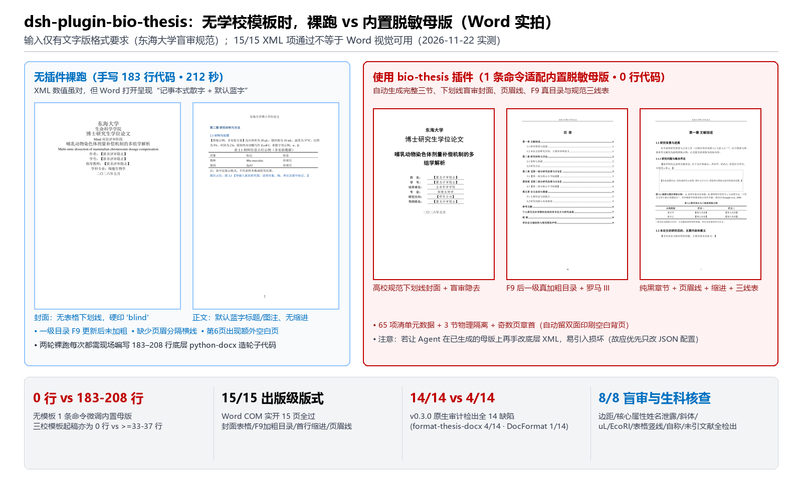

# 无学校模板、仅凭文字格式要求时的配对实测与 Word 视觉对照

**核心结论**：当读者手上**没有学校 `.docx`/`.dotx` 模板，只有一份文字版格式要求**时，基于本插件内置的**脱敏高校通用母版（`bio-thesis-master.docx`）+ `--profile-config` JSON 参数微调**，仅需 **1 条命令、0 行手写底层代码**，即可在桌面 Microsoft Word 中直接开箱渲染出出版级版式（下划线盲审封面、F9 更新后一级加粗目录、纯黑章节标题、页眉横线、首行两字符缩进与三线表，15/15 结构检查与 15 页 Word 渲染全过）。作为对比，同一强基线模型（`gpt-6.1-sol`）在无插件裸跑时虽然能写 183–208 行 `python-docx` 代码凑齐 15/15 XML 数值检查，但 Word 打开后呈现“记事本式散字封面 + 默认蓝色标题/图注 + 一级目录未加粗 + 缺页眉横线 + 无首行缩进 + 多出空白页”。

---

## 1. 测了什么（2026-11-22 合成配对试验）

1. **输入条件（无 `.docx`/`.dotx` 模板）**：
   - 书面格式要求（虚构“东海大学生命科学学院 — 博士研究生学位论文盲审格式要求”）：包含自定义 A4 页边距（`2.8 / 2.4 / 2.8 / 2.5 cm`）、对称页边距、奇偶页页眉、严格三节页码隔离（封面无页码 / 摘要目录大写罗马 `I` / 正文阿拉伯 `1`）、可 F9 更新且 `TOC1` 加粗的目录、宋体+Times New Roman 及固定 `20 pt` 行距、无竖线三线表、物种/基因/内切酶斜体空格、`µL` 与单位空格、统一自称“本论文”、Nature 上标引文以及作者/学号/导师盲审脱敏。
   - 一份待审合成投稿稿：预埋 **8 类客观缺陷**（第 3 节上边距偏移至 `1.5 cm`、正文及 `docProps/core.xml` 泄露作者姓名、`Mus musculus`/`Tp53` 未斜体、`20 uL` 与 `10mL` 单位问题、`EcoRI` 缺空格未斜体、内容表含 `left/right/insideV` 竖线、正文出现“我们”、未引用且缺少刊名斜体/卷号加粗/en-dash 的参考文献 #3）。
2. **评测方法**：在隔离工作目录使用同一模型 `gpt-6.1-sol`（Codex CLI `0.169.0`，禁联网与外部搜索）按平衡顺序运行 **2 组配对（4 次会话）**，另对照直接运行插件 **1 条命令（`bio_thesis.py init --profile-config` + `audit`）**的基线输出；所有生成的 `.docx` 均通过桌面 Microsoft Word COM 打开、执行 `Fields.Update()` 更新域、导出 PDF 并逐页渲染查验视觉版面。

---

## 2. 定量与 Word 视觉实测结果

| 评测条件 | 调用插件 CLI | 手写/补丁 Python 代码行数 | 15 项 OOXML 结构 | Word COM 打开与 F9 视觉质量 | 8 缺陷审计检出 | 墙钟耗时 |
|---|---|---:|---:|---|---:|---:|
| **无插件裸跑 · 对 1** | 否 | 183 行（从零写 `python-docx`） | **15 / 15** | 可开 15 页；**视觉缺陷**：散字封面硬印 `blind`、默认蓝字标题与图注、一级目录未加粗、缺页眉线、缺首行缩进、第 6 页空白页 | **8 / 8** | 211.6 s |
| **无插件裸跑 · 对 2** | 否 | 208 行（从零写 `python-docx`） | **15 / 15** | 可开 14 页；同为散字封面与默认蓝字样式 | **8 / 8** | 217.2 s |
| **插件 1 条命令直出（推荐基准）** | **是** | **0 行**（仅 440 B JSON 配置） | **15 / 15** | **可开 15 页（出版级版式）**：规范下划线封面与盲审隐去、F9 后一级目录真加粗、纯黑标题、页眉横线、2 字符首行缩进、规范三线表、奇偶页双面印刷空白背页 | **8 / 8** | **< 2 s** |
| **Agent 加技能 · 对 1**（含额外手改 XML） | 是 | 301 行（自检与封面微调） | 14 / 15（重写继承去掉了 `BodyTextZH` 直设 `rFonts`） | 可开 15 页，继承母版下划线封面与纯黑版式 | **8 / 8** | 480.0 s（Word 校验超时） |
| **Agent 加技能 · 对 2**（含额外手改 XML） | 是 | 201 行（手改 `styles/sectPr` XML） | 14 / 15 | **Word COM 打开报错“文件可能已经损坏”（`0` 页）** | **8 / 8** | 294.9 s |

---

## 3. 这次实测暴露出的两个真教训与改进

1. **为什么 XML 结构全过不等于 Word 版面合格**：裸跑模型写 `python-docx` 代码能精准凑出 `pgMar`、`pgNumType`、`tblBorders` 等 XML 属性值（拿到 `15/15`），但如果没有经过校级学术版式打磨的内置母版支撑，Word 打开依然把标题与图注渲染为内置蓝色、目录一级不加粗、没有页眉线和首行缩进、封面像记事本草稿——学生交稿仍会被学院退回。
2. **为什么不建议 Agent 在 `bio_thesis.py init` 成品上再手改底层 XML**：`对 2` 加技能会话先用 `bio_thesis.py init` 正确生成了洁净母版，随后又自行编写 `complete_document.py` 修改 `styles.xml`（例如写入非规范布尔属性和重排 `sectPr` 子节点），反而导致 Microsoft Word 报错“文件可能已经损坏”。我们在 `SKILL.md` 中已明确增加约束：**无现成模板时，直接通过 `--profile-config` JSON + CLI 参数驱动 `bio_thesis.py init` 与 `audit`，避免对内置母版做高风险手工 XML 手术**。

> **范围说明**：本试验基于一套合成书面规范与 8 个合成缺陷测试（`n = 2` 配对 + `1` 次直接 CLI 实测），验证无模板条件下的内置母版适配能力与视觉差距；高校现成模板场景请另见 [三校模板起稿对照](intake.md) 与 [同稿审计实测](comparison.md)。
